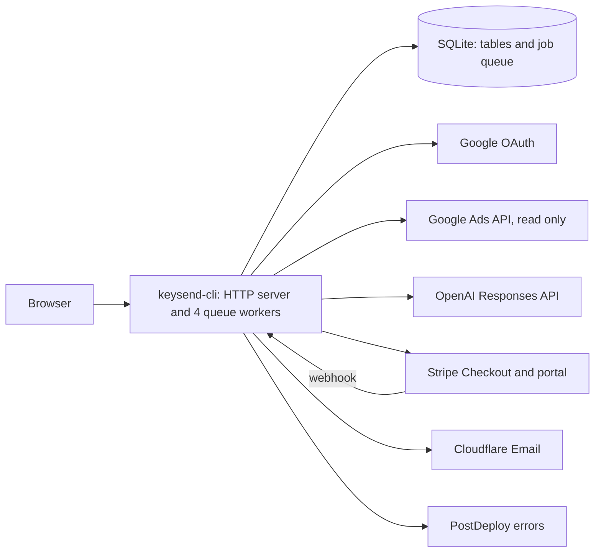

# KeySend

KeySend watches your Google Ads every day, tells you in plain English how things stand, and brings what matters to your attention. This repository holds the source of the application at [keysend.app](https://keysend.app).

| Read | For |
|---|---|
| `CONTEXT.md` | The terms |
| `AGENTS.md` | How to check a change |
| `CONTRIBUTING.md` | How a change gets into this repository |
| `docs/architecture.md` | The modules, the rules, and the daily run |
| `docs/features.md` | Each feature: its routes, its code, its tests, its behavior |
| `docs/database.md` | The tables and their foreign keys, written from the schema |
| `docs/adr/` | The reasons for the decisions that are hard to change |
| `LICENSE` | The licence, `AGPL-3.0-only` |



The diagram is written by hand. The external services are those that `src/settings.rs` configures.

## Run

`rust-toolchain.toml` pins the Rust version; `rustup` installs it on the first command.

```sh
cargo loco start          # http://localhost:5150
cargo test --locked
cargo fmt --all -- --check
cargo clippy --all-targets --locked -- -D warnings
```

The development database is `keysend_development.sqlite`. It holds the application tables and the job queue. The tests need no credentials: they call stubs of Google, Stripe, the AI and email.

The public pages work without any setting. Sign in with Google needs `GOOGLE_CLIENT_ID` and `GOOGLE_CLIENT_SECRET`; `src/settings.rs` reads these and the other keys from the environment. To see the signed-in pages without Google credentials, start the seeded server that `AGENTS.md` describes.

## Layout

| Path | Content |
|---|---|
| `src/` | Application code |
| `migration/` | Database migrations |
| `assets/views/` | HTML templates |
| `assets/static/` | CSS, fonts, and images, served at `/static` |
| `config/` | Loco configuration for each environment, and the list of cacheable public paths |
| `content/seo/catalog.json` | A sample of the articles, thoughts, guides and tools that the application publishes |
| `scripts/` | The seeded server, screenshots, the browser measurement and the module graph |
| `tests/` | Request tests |
| `docs/` | Architecture, features, the database, decisions |

## Content catalog

The application reads `content/seo/catalog.json` when it starts. The catalog in this repository is a sample with invented text. Its shape is:

```text
{schema_version: 1, entries: [{path, title, description, publish_at,
  kind, cluster, body_html}], calculator_js}
```

`kind` is `article`, `thought`, `guide` or `tool`, and the path starts with `/blog/`, `/thoughts/`, `/guides/` or `/tools/`. An entry is hidden until its UTC `publish_at`. `calculator_js` is the one script of the tool pages; the response allows it by its hash.
