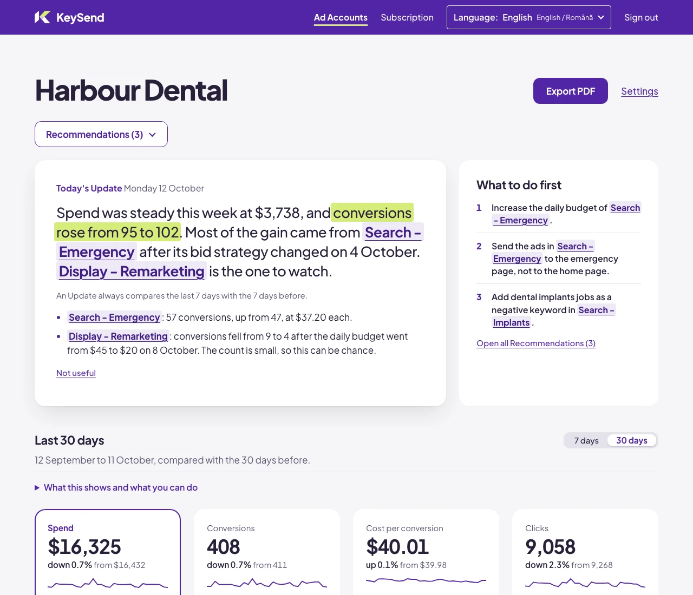
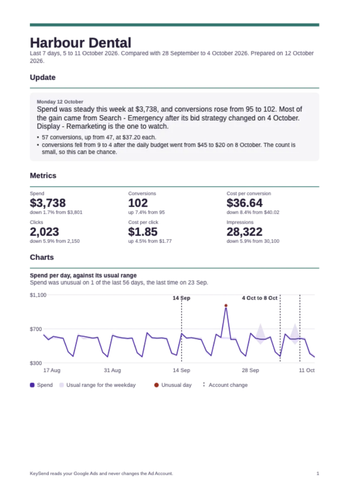
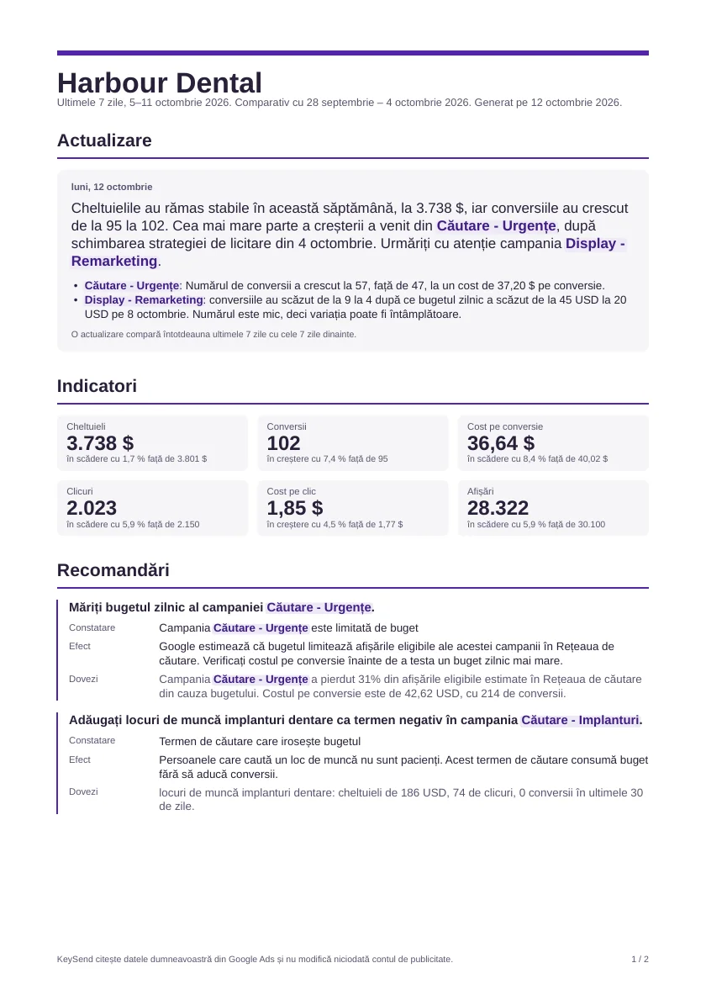

<h1 align="center">KeySend</h1>

<p align="center">
  Know what changed in Google Ads.<br>
  Send a report your clients can understand.
</p>

<p align="center">
  <a href="https://keysend.app">Website</a> ·
  <a href="https://keysend.app/sign-in">Start a free trial</a> ·
  <a href="https://keysend.app/ro">În română</a> ·
  <a href="#run-locally">Run locally</a>
</p>

<p align="center">
  <a href="LICENSE"></a>
  <a href="rust-toolchain.toml"></a>
  <a href="https://keysend.app/security"></a>
</p>



KeySend reads your Google Ads accounts each day, explains performance changes, and brings problems to your attention. It is built for independent consultants, freelancers, and small agencies who manage client accounts.

Use the hosted application at [keysend.app](https://keysend.app), or run the source locally. KeySend reads your advertising data. It never changes bids, budgets, keywords, or ads.

## What you can do

- **See what changed.** Daily updates explain movements in spend, clicks, impressions, and results. Review account changes alongside performance and investigate possible causes.
- **Check the numbers.** Switch between 7-day and 30-day trends. Compare each day with earlier matching weekdays, with the historical range explained beside the chart.
- **Investigate wasted spend and opportunities.** Review search terms, keyword quality, and available breakdowns. Search impression-share estimates show where budget or rank may limit visibility.
- **Review recommendations before acting.** Read the observation, its supporting data, and the proposed action. Make the changes yourself in Google Ads.
- **Keep clients informed.** Receive alerts and a weekly email, then export account or campaign reports as PDFs in English or Romanian.
- **Work in your language.** The application supports English, Romanian, German, Spanish, French, Italian, and Portuguese. The language selected in the header also controls PDF exports: Romanian for Romanian, English for other languages.

KeySend keeps tracking limitations visible. When conversion data is incomplete or too recent, reports explain what can be judged from the available data.

<p align="center">
  
  
</p>

The screenshots and sample reports use fictional accounts and data.

## Get your first update

1. [Sign in with Google](https://keysend.app/sign-in) using the login you use for Google Ads.
2. Connect Google Ads and select the accounts you want KeySend to monitor.
3. Read your updates, explore a campaign, and export a report when you need one.

The hosted application includes a 14-day trial with no payment card. See [current pricing](https://keysend.app/#price) for the subscription and account allowance.

## Hosted application or local source

| | [keysend.app](https://keysend.app) | This repository |
| --- | --- | --- |
| Getting started | Sign in and connect Google Ads | Install Rust and start the application |
| Hosting and updates | Managed for you | You operate and maintain the application |
| External services | Configured for the hosted application | Configure your own service accounts and credentials |
| Content | Published articles, guides, and tools | A sample content catalog |

This repository contains the application source, tests, and documentation under [AGPL-3.0-only](LICENSE). It receives source snapshots. Production infrastructure, real credentials, and production editorial content are excluded.

## Run locally

Install [Rust through rustup](https://rustup.rs/), then run:

```sh
git clone https://github.com/abpaul/keysend.git
cd keysend
cargo loco start
```

Open http://localhost:5150. The pinned toolchain is installed on the first Cargo command. SQLite stores application data and background jobs in `keysend_development.sqlite`.

Public pages work without credentials. Google sign-in needs your Google client ID and secret. Connected-account monitoring and other integrations need their service configuration. Read [encrypted credentials](docs/credentials.md) for the supported settings and setup.

To explore signed-in pages with fictional data, use the [seeded browser workflow](AGENTS.md#signed-in-pages-in-a-browser). It needs no Google credentials. This checkout does not include a production deployment guide.

## Development

Run the shared checks before you commit:

```sh
scripts/check.sh
```

The checks run formatting, vendored-source validation, Clippy, and the test suite with a separate temporary SQLite database. Tests use stubs for Google, Stripe, AI, and email. CI can be started manually.

| Read | For |
| --- | --- |
| [Features](docs/features.md) | Application behavior, routes, and tests |
| [Architecture](docs/architecture.md) | Modules, data flow, and background jobs |
| [Database](docs/database.md) | Tables and relationships |
| [Credentials](docs/credentials.md) | Environment settings and encrypted configuration |
| [Contributing](CONTRIBUTING.md) | How changes reach the public source snapshot |
| [Project terms](CONTEXT.md) | Names used in the code and documentation |
| [Architecture decisions](docs/adr/) | Reasons behind the implementation |

<details>
<summary>About the sample content catalog</summary>

The application loads `content/seo/catalog.json` at startup. This repository supplies fictional articles, thoughts, guides, and tools. Each entry contains a path, title, description, publication date, kind, cluster, and HTML body. Future entries stay hidden until their UTC publication date. The catalog also contains the tool-page script.

</details>
