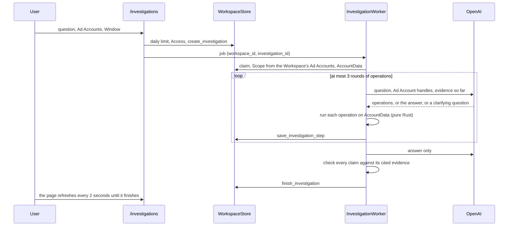

# The Agent

A User asks a question in words about the Ad Accounts of their Workspace, such as "Why did conversions drop last week?". KeySend investigates the Account history and the latest Deep check and answers with what the data shows, what might explain it, what to do next and what remains uncertain. Each statement cites the evidence it rests on. The Agent reads; it never changes an Ad Account.

`docs/agent-research.md` gives the published work behind the design. `docs/agent-evaluation.md` gives the measured results. `docs/features.md` lists the routes, the code and the tests under Investigations.

## How an investigation runs

The states are Created, Gathering, Answering, Completed, Failed and Cancelled (`src/agent/mod.rs`). `State::may_become` holds the only transitions, and the store applies them in SQL, so a job that runs twice cannot run the loop twice and a finished investigation never changes.

Each model round is one request to the Responses API with a strict JSON schema (`src/agent/investigation.rs`). The model returns either operations to run, the answer, or a clarifying question. Code decides when the model may no longer ask for operations: the last round's schema has no investigate step. The schema lists the evidence IDs that exist, so an answer cannot cite evidence that no operation returned.

## The operations

The model chooses business operations, not queries. Each is a variant of `Operation` (`src/agent/operation.rs`) with typed arguments; unknown fields, unknown variants, a customer ID in place of a handle and a row count above 20 are refused when the arguments are parsed. Every operation runs on `AccountData` (`src/agent/data.rs`), a snapshot that the job reads through `WorkspaceStore`. No operation calls Google Ads, writes to the store, or takes SQL or GAQL. The calculations are the existing ones of `src/monitoring/`.

| Operation | Arguments | Returns | Source |
|---|---|---|---|
| `rank_accounts` | period | Each Ad Account of the investigation with its Metrics, Conversion tracking and active Findings, by spend | Account history, Deep check Findings |
| `account_overview` | account, period | Metrics against the previous period, Conversion tracking, profile goal, note and target, break-even values, active Findings | Account history, Ad Account profile, Findings |
| `compare_periods` | account, period | Metrics against the previous period and the same days last year, movements outside normal variation, Contributions and Cause candidates | Account history, detection, causes |
| `compare_campaigns` | account, period, order, rows | The Ad Account row and the Campaigns ranked by spend, spend change, conversion change or cost per conversion change | Account history |
| `investigate_conversions` | account | Tracking state including stops and spikes, enabled actions, conversions by action and week, conversion delay, unsettled days | Account history, conversion actions, Deep check |
| `investigate_search_terms` | account, campaign or none, focus, rows | The search terms with the most spend, or those with spend and no conversions, with their totals and the share of spend they cover | Latest Deep check (30 days, top 200 terms) |
| `investigate_segments` | account, segment | Devices with the previous period; locations, hours or demographics of the latest Deep check; cost per conversion and shares | Account history, Deep check |
| `review_economics` | account | Margin, customer value, close rate, target return and the break-even values that code derives, with the missing inputs | Ad Account profile |
| `review_history` | account | The latest Assessment, active and resolved Findings, Recommendations with their state and what followed, Account changes with their Follow-ups | Deep check, Recommendation history, Account history |
| `business_context` | account | Only verified research facts with their sources and date | Business context of the Deep check |

Each operation returns at most 20 rows, ranked, and says how many it left out. An identical operation is not run twice in an investigation; the step is stored as repeated.

## Evidence

Each row is an `Evidence` (`src/agent/evidence.rs`): an ID such as `E2.3` (the third row of the second operation), the Ad Account handle, the source, the subject (the Ad Account, a Campaign with its ID and name, a search term, a segment, a conversion action), the days and the baseline days, the facts as KeySend displays them, a strength and its caveats.

Code sets the strength from counts (`run::strength`): Weak when Conversion tracking is not working, when either period has fewer than 10 conversions, or when there is no baseline; Limited under 30 conversions or with days whose conversions are not settled; otherwise Strong. Spend and click evidence is Strong with 100 clicks in both periods. Configured economics are Strong when their inputs are present. The model never sets a strength.

Caveats are facts the answer must show: days not settled, few conversions, tracking not working, a search-term list that is a snapshot of the top terms, data from the Deep check rather than the period, rows left out, no baseline, a missing profile input.

## The answer and its check

The model drafts a summary, observations, hypotheses, Recommendations and limitations, each claim citing evidence IDs. `answer::check` (`src/agent/answer.rs`) keeps a text only when:

- every number, percentage, amount and capitalized name in it occurs in the evidence it cites, or in the request itself (the period, the day, the Ad Account names, Google Ads acronyms), written as displayed (`monitoring::claims::grounded`, the check of the Assessment);
- no percentage moves in the opposite direction from its evidence;
- an observation gives no reason; a hypothesis gives one only with may, might, could or probably; a Campaign name cannot supply a causal word;
- a Recommendation targets a subject of its cited evidence, the Ad Account, or a Campaign that a fact of its cited evidence names as a whole value, and a Recommendation to make a change does not rest on Weak evidence;
- it repeats no earlier text of the same answer.

The strength of a claim is the weakest strength of its evidence. Every caveat of cited evidence becomes a limitation. The page says how many texts the check left out. Evidence IDs that the model writes into a text, such as `[E2.1]`, are removed before the check; the citations carry them. There is no second request to repair a refused answer: in the evaluation it was kept in 6 of 32 cases and used a quarter of the input tokens (`docs/agent-evaluation.md`, Round 2).

## Follow-ups

A follow-up is a new investigation with `follows` set to the earlier one, in the same Workspace, with the same Ad Accounts and Window. The model receives the earlier question, its summary, observations and Recommendations, and the evidence they cited, renumbered `E0.n`. It does not receive earlier transcripts or the rest of the thread.

## Authorization and security

- The job takes the Workspace from its arguments, which only the signed-in User's request writes, and builds a `WorkspaceStore` for it; every query filters on that Workspace.
- `Scope::load` takes the Ad Accounts only from the Workspace's own list. Handles use the positions in the investigation's stored Ad Account list, in the order the User submitted; a rename does not change a handle, and an Ad Account no longer owned leaves its position unused. The worker and the thread page share this mapping. The model sees each Ad Account as a handle (`A1` to `A5`) and never a customer ID; `run::run` resolves a handle only within the scope and refuses a snapshot of another customer.
- Every route of another Workspace's investigation, follow-up or cancel answers not-found. POST routes pass the same-origin check of `src/security.rs`.
- There is no write operation. The Agent does not call the Google Ads client, and no operation or answer can create a change: changes are Optimize Proposals, which code builds from Signals (`docs/optimization.md`). A request test asserts that an investigation makes no Google Ads request.
- Campaign names, search terms, landing pages, research, the profile note, the question and earlier answers reach the model only as JSON string values. The instructions say they are data. The defense does not depend on the model obeying: the operations are typed and read-only, the scope is fixed by code, and the answer is checked and rendered with escaping.
- Search-term text is public input. Before it becomes Evidence, code replaces email addresses with `[email]` and phone-like runs of seven or more digits with `[phone]`, so those contact details reach neither the AI provider nor the stored investigation evidence.
- The Ad Account profile note and verified Business context facts are sent to the AI provider when their operations run. Other free text, including the User's question, is sent as entered; search-term redaction is not a general scrubber of every field.
- The request sends `store: false`. Authentication emails, customer IDs, tokens and cookies are not included as request fields.

## Limits

`settings.agent` (`investigation::Limits`) holds the limits; the values below are the defaults, chosen before measurement.

| Limit | Default |
|---|---|
| Operations per investigation | 8 |
| Rounds with operations | 3, then one answer-only round |
| Operations per round | 4 |
| Time for the investigation | 60 seconds, data loading and model requests included |
| Input tokens per investigation | 80,000, counted before each request is sent (below) |
| Estimated cost per investigation | $0.25 when the model has a price in `services.ai_prices`, counted before each request is sent |
| Output tokens per round | 4,000 |
| Retries | one per round when the answer is outside the schema |
| Investigations per Workspace | 20 in 24 hours |
| Rows per operation | 20 |
| Question length | 500 characters |

Before each request, code projects its input tokens as one token per three bytes of the request, which errs on the side of the limit, and adds the full output allowance. A round with operations is sent only when twice its projection still fits, so that its answer round fits too; otherwise the round asks for the answer only. The answer round is sent only when it fits; otherwise the investigation fails as Budget without a request (`investigation::Budget::admits`). With a price for the model, the projected cost must also stay within `usd`. A model without a price keeps the token limit: a missing price never removes the limit. The User's question, the operations and the answer are unchanged by this.

The daily count and creation take the same SQLite write transaction. Data loading and the investigation share a hard timeout of twice the time limit, capped at 240 seconds (below the six-minute queue reaper); reaching it fails the investigation as Budget.

A job that stops in Gathering or Answering is failed as Interrupted once its claim is older than three times the time limit; the User can ask again. A failed investigation is never retried by itself.

## Retention

The daily retention job deletes an entire investigation thread, including its steps, only when its newest investigation is more than 180 days old. Removing an Ad Account deletes investigations whose stored Ad Account list contains it, together with their follow-ups through the cascade. Removing a Workspace deletes all its investigations and steps. The token totals of the model requests are kept in `operation_days` with the other AI operations, for 24 months, without the Workspace.

## Cost

Each investigation stores its model calls and known tokens. `docs/agent-production.md` gives the measured size of KeySend's own requests, which is far below the evaluation's Codex totals. A provider call cut off by a timeout can still be billed, but its tokens are unknown because no usage response was received. The admin dashboard estimates the cost of all AI operations from `services.ai_prices`. `docs/agent-evaluation.md` gives the measured tokens per investigation; the cost of a month for one Workspace is that number of tokens times the price of the model times the investigations of the month, at most 20 a day.
