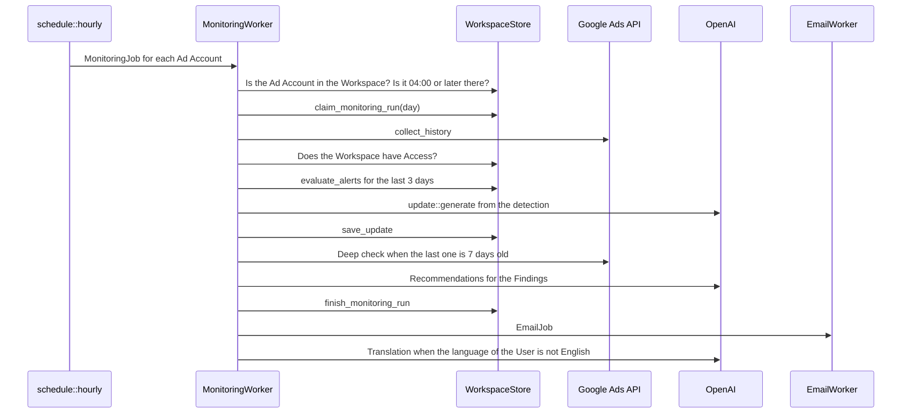

# KeySend architecture

The code is the record. This page shows where things are and states the rules that the code cannot state. `CONTEXT.md` defines the terms. `docs/adr/` gives the reasons for the decisions that are hard to change.

## System

One Rust application (Loco, Axum, SeaORM) in one container. It serves the pages and runs the queue workers. One SQLite file in WAL mode holds the tables and the job queue (ADR 0001).

The README has the system diagram.

## Modules

`cargo loco routes` prints every route. `python3 scripts/module-graph.py` prints the imports between these modules as a Mermaid diagram. It reads `crate::` paths as text, so it does not see a path that a macro writes. `docs/database.md` shows the tables.

| Module | Responsibility |
|---|---|
| `src/app.rs` | Routes, middleware, workers, the hourly scheduler |
| `src/controllers/` | One file for each group of routes. A handler reads the request, calls the store and the builders, and renders a template |
| `src/auth.rs`, `src/identity/` | The session cookie, the `Authenticated` extractor, Users, sessions, OAuth states |
| `src/workspace/` | `WorkspaceStore`: every read and write of a row that a Workspace owns. `OperatorStore`: read-only cross-Workspace projections for admin pages |
| `src/removal.rs` | Deletion of a Workspace: revoke the Google tokens, delete the Stripe customer, then delete the rows. User deletion and the retention job call it |
| `src/google.rs` | Google OAuth: token exchange, refresh, revoke, and the list of Ad Accounts of a Google Connection |
| `src/google_ads.rs`, `src/google_ads/` | The Google Ads client (`googleAds:search`, and `mutate.rs` for Optimize) and the collection of the Account history and the Deep check data |
| `src/monitoring/` | The daily run: Metrics, movement detection, Findings, Updates, Recommendations, Alerts, the emails, the charts, the Export, and the daily retention job |
| `src/agent/` | Read-only Investigations: bounded operations on Workspace data, checked answers, evidence and the queue worker |
| `src/optimize/` | Optimize: Signals, Proposals, the Optimization policy, execution with read-back and reconciliation, Outcomes, and its queue worker. No model call (`docs/optimization.md`) |
| `src/google_ads/mutate.rs` | The only code that sends a change to Google Ads: a budget amount or a Campaign status, one operation per request |
| `src/ai.rs` | The one OpenAI request function and the checks on its answer |
| `src/translation.rs`, `src/translation/` | Translation of stored text, with names and numbers masked |
| `src/language.rs`, `src/language/` | Every text of the interface, one `Text` value for each language |
| `src/billing.rs`, `src/billing/` | Stripe requests, webhook verification, and the task that prepares a Stripe account |
| `src/security.rs` | Response headers, the cache policy, the same-origin check for POST |
| `src/content.rs`, `content/seo/` | The public articles, guides and tools, with their publication dates |
| `src/assets.rs` | Static files with a content hash in the name |
| `src/crypto.rs` | Encryption of Google refresh tokens with the master key |
| `src/settings.rs`, `src/settings/credentials.rs`, `src/bin/credentials.rs` | Settings, the clock, a context-owned snapshot of ENV or encrypted credentials, and scoped operator commands using the same credential schema |
| `migration/` | The schema. One file for each change |

## Rules

- SQL is only in `src/workspace/` and `src/identity/`. Other modules call `WorkspaceStore`, which always has a Workspace. Anonymous operation totals and business snapshots use the explicit connection-taking functions in `workspace::measurement`. Authenticated admin handlers use `workspace::operator::OperatorStore` for read-only cross-Workspace queries. A test (`tests/requests/boundaries.rs`) fails when another module names a database type or call.
- A handler takes the signed-in User from the `Authenticated` extractor. A handler of a route with an Ad Account takes `OwnedAdAccount`, which answers not-found for an Ad Account of another Workspace.
- A text for the interface goes in `language::Text`; a missing text does not compile. `src/language.rs` explains how to add one.
- Product dates (days, Windows, the Trial, Updates, Alerts) read `Settings::now()`, which a test can set. Machine time (the expiry of a session, a request timestamp) reads `settings::wall_clock()`. Clippy refuses `Utc::now()`.
- Stored text is English. Pages and emails read the translation and fall back to English. Romanian Exports require the translation of their stored text. Exports follow the saved User language, Romanian or otherwise English.
- AI never creates a Metric, a Finding or a Cause. A Recommendation is kept only when it cites a detected Finding and its numbers (`src/monitoring/recommendation.rs`). Code builds the Cause candidates with their level and evidence (`src/monitoring/causes.rs`); AI only chooses one for a text and words it, and the check lets a text use causal words only in a sentence that also holds an anchor of the chosen Confirmed or Likely cause (for example the date of the Account change), and a Likely cause also needs "most likely" or "probably" in that sentence. A Contribution unlocks no causal word.
- The Result of an Assessment and every number in it come from code (`src/monitoring/assessment.rs`). AI words the headline and the points from that evidence; each text keeps only the names and numbers of the evidence, written as displayed, has no causal word, and a point of what worked or needs attention shows a number. Without AI, or for a text that fails the check, code writes the Result and its evidence.
- Only a verified Stripe webhook grants Access.
- A change to an Ad Account is an `optimize::Action`, built by code. It runs only through `optimize::execute::run`, after an Approval bound to its fingerprint or an Autopilot authorization under the current policy version, with `settings.optimize.live` on. The Agent and every GET route are read-only; no model output reaches an `Action`.
- Every page works without scripts.

## Measurement

`src/workspace/measurement.rs` records daily Workspace activity and anonymous operation totals.
Only Viewed, Exported and Feedback activity counts as User activity; Connected, Synced and
Assessed describe activation. Recording errors are logged and never fail product work.
The hourly scheduler stores one UTC business snapshot per day. These three daily tables
are kept for 24 months; Workspace activity and Subscription changes cascade on removal.
`subscription_changes` records observed status or scheduled-cancellation transitions in the
existing billing transaction. Registration dates and successful collection times are recorded
prospectively; older dates remain unknown. Optional model prices in `settings.services.ai_prices`
allow token cost estimates; an absent price means Not configured.

## The daily run

Read from `src/monitoring/worker.rs`.

