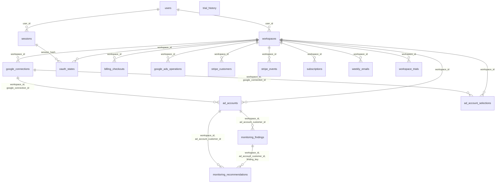

# KeySend database

A test writes this page from the migrated schema (`tests/requests/database_diagram.rs`). Do not edit it. After a migration, write it again:

```sh
KEYSEND_WRITE_DIAGRAMS=1 cargo test --locked --test mod database_diagram
```

Each line is a foreign key, with its columns. Every foreign key deletes its rows with the parent row. The diagram does not show which relations are one-to-one.



## Tables of one Ad Account

Each of these tables has one foreign key, to `ad_accounts`, and no table refers to it.

| Table | Primary key |
|---|---|
| `account_changes` | `workspace_id`, `ad_account_customer_id`, `changed_at`, `resource_name` |
| `account_history` | `workspace_id`, `ad_account_customer_id` |
| `ad_account_metadata` | `workspace_id`, `ad_account_customer_id` |
| `ad_account_profiles` | `workspace_id`, `ad_account_customer_id` |
| `alert_evaluations` | `workspace_id`, `ad_account_customer_id`, `day` |
| `alerts` | `workspace_id`, `ad_account_customer_id`, `day`, `event_key` |
| `branding` | `workspace_id`, `ad_account_customer_id` |
| `breakdown_history` | `workspace_id`, `ad_account_customer_id`, `kind` |
| `campaign_days` | `workspace_id`, `ad_account_customer_id`, `day`, `campaign_id`, `device` |
| `campaign_network_days` | `workspace_id`, `ad_account_customer_id`, `day`, `campaign_id`, `network` |
| `campaign_search_share_days` | `workspace_id`, `ad_account_customer_id`, `day`, `campaign_id` |
| `campaign_settings` | `workspace_id`, `ad_account_customer_id`, `campaign_id` |
| `campaigns` | `workspace_id`, `ad_account_customer_id`, `campaign_id` |
| `conversion_action_days` | `workspace_id`, `ad_account_customer_id`, `day`, `campaign_id`, `action` |
| `conversion_lag_totals` | `workspace_id`, `ad_account_customer_id`, `day`, `bucket` |
| `deep_check_failures` | `workspace_id`, `ad_account_customer_id` |
| `deep_checks` | `workspace_id`, `ad_account_customer_id` |
| `demographic_totals` | `workspace_id`, `ad_account_customer_id`, `day`, `kind`, `value` |
| `google_failures` | `workspace_id`, `ad_account_customer_id` |
| `hour_totals` | `workspace_id`, `ad_account_customer_id`, `day`, `weekday`, `hour` |
| `keyword_quality` | `workspace_id`, `ad_account_customer_id`, `day`, `campaign_id`, `ad_group_id`, `criterion_id` |
| `location_totals` | `workspace_id`, `ad_account_customer_id`, `day`, `location_id` |
| `monitoring_runs` | `workspace_id`, `ad_account_customer_id`, `day` |
| `monitoring_settings` | `workspace_id`, `ad_account_customer_id` |
| `translations` | `workspace_id`, `language`, `source_hash`, `ad_account_customer_id` |
| `updates` | `workspace_id`, `ad_account_customer_id`, `day` |
