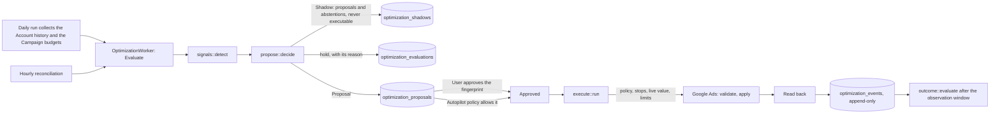

# Optimize

Optimize proposes changes to an Ad Account from its Account history, asks the User to approve each one, applies an approved change through Google Ads, reads it back, and reports what followed. An Ad Account can also run an Autopilot: a policy that lets a small set of changes run without asking, inside limits the User sets.

**Applying is switched off.** `settings.optimize.live` is `false` in every committed configuration. The installation ceiling defaults to Shadow. With applying off, the User can review permitted proposals and reject them; nothing is approved and no edit request reaches Google Ads. "Compliance and the release gate" below lists what must happen before it is switched on.

`docs/optimization-security.md` gives the authorization boundaries and the security tests. `docs/features.md` lists the routes, the code and the tests under "Optimize".

## Investigations, Assessments, Recommendations and Optimize

| | What it is | Who writes it | Changes the Ad Account |
|---|---|---|---|
| Investigation | An answer to a question, with cited evidence | AI words it; code checks every number | Never |
| Assessment | The weekly reading of a Deep check | Code sets the Result; AI words the points | Never |
| Recommendation | An action that a Finding supports, in words | AI proposes from a detected Finding | Never; the User acts in Google Ads |
| Proposal (Optimize) | One exact typed change, with its current and proposed value | Code only | Only after an Approval, or under an Autopilot policy, and only when applying is on |

A Recommendation tells the User what to look at. A Proposal is a change that KeySend can make itself, so code builds it, a policy limits it, and the User approves its exact value.

## What is code and what is a model

Everything in Optimize is code: the Signals, the Proposals and their values, the policy, the Approval check, the execution, the read-back, the reconciliation and the Outcome. No model call is made by Optimize, so an evaluation costs no tokens. The explanation of a Proposal is built from the Signal's numbers with the language tables, so a Proposal reads the same in every language and states no number that code did not measure.

The brief allowed a model to choose among permitted Proposals. Every current choice is a rule (one change of spend per Campaign, the largest spend first), so a model would add cost without a decision to make. This is recorded as a deliberate omission; see "Rejected" in `docs/agent-research.md`.

## The pipeline

### Modes

| Mode | What happens |
|---|---|
| Investigate (default) | Nothing is proposed. Connecting an Ad Account never enables anything else. |
| Shadow | With explicit consent, the same decision process records non-executable proposals and abstentions. Nothing can be approved or sent. |
| Recommend and apply | Proposals are made; each one runs only after the User approves it on its page. |
| Autopilot | Proposals that the policy allows run without asking; every other Proposal waits for the User. |

### Signals (`src/optimize/signals.rs`)

Only settled days count: the last day, or the last week when a quarter or more of the Ad Account's conversions arrive two days or more after the click. The window is the 30 settled days. The target is the policy's target cost per conversion, else the Ad Account profile's target, else the break-even cost of the profile's economics; with none of them, Optimize judges nothing.

Evidence is a Poisson count (`src/optimize/stats.rs`): if the Campaign converted at the target, how often would it record this few conversions for its spend? A Signal needs that chance below 5%.

| Signal | Rule |
|---|---|
| Cost above target | At least `min_conversions` (10) whole conversions, a cost per conversion at least 1.3 times the target, and the chance below 5%; no cost cut when the profile's break-even cost covers the observed cost |
| Spend without conversions | No conversion, at least 30 clicks, and spend above three target costs per conversion (chance `e^-3` below 5%) |
| Budget limited | At least `min_conversions`, a cost at most the target divided by 1.1 beyond chance, at least 10% of Search impressions lost to budget in the latest Deep check, and the last 7 settled days spending 90% of the budget |
| Search term without conversions | A term of the latest Deep check with at least 30 clicks, no conversion, and spend above three target costs per conversion; at most 3 per Campaign |
| Conversion tracking unreliable | The Ad Account's Conversion tracking is not Working, or a Finding says tracking stopped, spiked or is not set up. No change of spend is judged. |

An open Proposal is kept while its Signal holds at the clearing level (1.1 times the target for cost), not the entry level (1.3), so that a value near the threshold does not open and close a Proposal every day.

### Proposals and holds (`src/optimize/propose.rs`)

| Signal | Change | Risk | Approval |
|---|---|---|---|
| Cost above target | Cut the daily budget by `max_decrease_percent` (20%) | Medium | User, or Autopilot when allowed |
| Budget limited | Hold: no authoritative live account-wide total proves the spending envelope | High | Budget increases are unavailable |
| Spend without conversions | Pause the Campaign | High | Always the User |
| Search term without conversions | Add the term as an exact negative keyword of the Campaign | Medium | User; applying is not implemented |

A budget step is rounded toward the current value to the currency's smallest unit, so rounding never passes a limit. Every Signal gives at most one change of spend per Campaign, and at most 5 Proposals are open in one Ad Account, the largest spend first.

A Signal gives no change, with a stated reason, when: the Ad Account is in Investigate mode; Conversion tracking is unreliable; the newest data is older than `max_data_age_days`; the Account history is shorter than 60 days; the Campaign is protected or outside the policy's Campaigns; anyone changed the Campaign within `cooldown_days` (Account changes from Google and KeySend's own executions); KeySend changed it in the opposite direction within `observation_days`; the budget is shared; the budget is unknown; the Campaign spends less than the cut budget (a cut would change nothing); the authoritative account-wide budget total needed for a raise is unavailable; fractional conversion credits do not meet the exact-count model; the same Proposal is open; or the User rejected it in the last 30 days. The Optimize page lists these reasons for each Ad Account.

### The Optimization policy (`src/optimize/policy.rs`)

Each save is a new version; versions are never edited (a trigger refuses it). The current version applies to the next change at once. Saving the settings never resumes a suspended or switched-off Autopilot; only its own control does.

| Setting | Default | Allowed |
|---|---|---|
| Mode | Investigate | Investigate, Shadow, Recommend and apply, Autopilot, bounded by the installation ceiling |
| Changes the Autopilot may make without asking | none | budget reductions only |
| Largest cut / raise per change | 20% / 10% | 1–50% / 1–30% |
| Daily budgets of enabled Campaigns, at most (envelope) | none: no raise | any amount |
| Raises in one day, at most | 0 | any amount |
| Changes in one day | 3 | 1–10 |
| Cooldown after any change of a Campaign | 7 days | 1–90 |
| Observation window | 14 days | 7–90 |
| Conversions before a cost is judged | 10 | 5–1000 |
| Newest data at most | 2 days old | 1–7 |
| Failed changes in 7 days that suspend the Autopilot | 2 | 1–10 |
| Spend rise that suspends the Autopilot | 50% | 10–500% |
| Protected Campaigns, eligible Campaigns, target cost | none | |

Rules that no setting lifts: only budget reductions may run automatically. Campaign pauses require exact User Approval. Budget increases are held because the current adapter cannot establish an authoritative account-wide budget total. Shared budgets are excluded. Negative keywords remain recommendations and cannot execute.

A daily budget is not a ceiling: Google Ads can spend up to twice the average daily budget on one day and limits the month to about 30.4 daily budgets. The policy page and every budget Proposal say so.

### Approval

The Proposal page shows the current and the proposed value, the Campaign, the risk, what KeySend measured, what it might mean, the direction to expect, what could go wrong and how the result will be measured. Approving submits the Proposal's fingerprint: a SHA-256 of the Ad Account, the exact change, the policy version and the expiry. The store approves only an open, unexpired Proposal whose fingerprint is the submitted one, and stores that fingerprint. A trigger refuses any change to a Proposal's change, fingerprint or key after it is made, so what runs is what was approved. A Proposal expires after 7 days. There is no batch approval. An approved change that finds another change of the Ad Account running waits, and the hourly reconciliation queues it again once that change is settled.

### Execution (`src/optimize/execute.rs`)

1. The Proposal is Approved and its stored Approval equals its fingerprint, recomputed from the row.
2. It has not expired; the Workspace is not stopped; the kind is live (`settings.optimize.live` and `settings.optimize.actions`).
3. An automatic Proposal still has the policy version it was authorized under; any later version, including a switch-off, refuses it.
4. The current policy allows the change (mode, eligibility, step, envelope, daily raise, cooldown, observation).
5. The store claims it in one write transaction that counts the day's changes and raises and refuses while another change of the Ad Account is Applying or Uncertain. Two workers cannot pass a limit together.
6. KeySend reads the live Campaign and budget. A different budget, a shared budget, or another status stops it as a Conflict; nothing is sent.
7. Google Ads validates the change (`validateOnly`). After validation, KeySend reads the live resource again and checks Access, the Workspace stop and the current policy, so a stop or a switch-off pressed during the read still prevents it. Google Ads then applies it: one operation, an exact `updateMask`, `partialFailure` off, `MUTABLE_RESOURCE` in the answer. The `request-id` is stored.
8. KeySend reads the value back. Only the intended value makes the Proposal Applied.

When the answer to the change is lost (timeout, 5xx), KeySend reads the live value before anything else: the intended value means Applied; the value before does not establish that the request failed and remains Uncertain; anything else is a Conflict that suspends the Autopilot. If the read also fails, the Proposal stays Uncertain, blocks other changes of the Ad Account, and the hourly reconciliation settles it by reading, never by sending again.

### Outcomes (`src/optimize/outcome.rs`)

KeySend keeps three results apart: the change was sent; Google Ads holds the intended value (the read-back); and what the numbers did afterwards. The last compares the 14 settled days after the change with the 14 before, requiring distinct collected Campaign-day rows in both windows rather than elapsed calendar time, for the Campaign and for the rest of the Ad Account, and judges a count only beyond chance. States: waiting for enough settled days, results moved the expected way, results moved the other way, no clear change (also when the rest of the Ad Account moved the same way beyond chance), results cannot be judged (tracking), and check it yourself (another change of the Campaign in the window). Each change of state is a line in the history. The page says what followed, never that the change caused it.

### Recovering an uncertain execution

An old-value read never authorizes a resend or proves that the request failed. The User may record a provider-confirmed terminal non-application on an Uncertain Proposal with its fingerprint, an explicit confirmation and a supporting reference or note. `/optimize/proposals/{id}/recover` records the User identity and evidence, marks the execution Failed with `verified=false`, and switches the current policy to Investigate and Suspended in one transaction. It retires other pending proposals. The history calls this an unverified User report; KeySend has not independently verified Google's confirmation. Applying proposals cannot use this action, audit failure rolls everything back, and repeated submission adds no new event. It sends no request to Google Ads. New changes require an explicit settings save; the Autopilot resume control alone cannot restore a write mode. A false confirmation remains an operator risk, so do not use repeated old-value reads as that confirmation.

### Emergency controls

| Control | Effect |
|---|---|
| Stop all changes (Workspace) | No change runs; approved changes that have not started fail with the reason; Proposals and monitoring continue. Only the User resumes. |
| Switch off the Autopilot (Ad Account) | A new policy version, Revoked; automatic Proposals authorized earlier are refused. User approvals still run in Recommend. |
| Automatic suspension | A new version, Suspended, when Google refuses access (revoked token or role), changes fail `stop_after_failures` times in 7 days, a live value conflicts, Conversion tracking is unreliable, the newest data is too old (collection failed), or the newest day's spend rose past `stop_spend_rise_percent`. A suspended Autopilot never resumes by itself. |

Two triggers in the brief are not used, by design: missing AI pricing (Optimize makes no model call; Investigations enforce their own token and priced-cost limits) and excessive volume (bounded by the 5 open Proposals and the daily change limit rather than detected after the fact).

## Storage

| Table | Holds |
|---|---|
| `optimization_policies` | Each version of each Ad Account's policy, with its standing and reason. Append-only. |
| `optimization_stops` | The Workspace stop. |
| `campaign_budgets` | The budget ID, whether it is shared and how many Campaigns use it, collected with the Campaigns every day. |
| `optimization_proposals` | Each Proposal, its fingerprint and state. The change and fingerprint cannot be updated. |
| `optimization_executions` | One per run Proposal: the live state before and after, the request ID, the error, whether it was verified. |
| `optimization_events` | The history: every Proposal, decision, execution step, policy version, stop and Outcome. Append-only. |
| `optimization_evaluations` | The last evaluation of each Ad Account, with its holds. |

The history does not reference Investigations, so deleting an Investigation does not touch it. It is kept with its Ad Account: removing the Ad Account or the Workspace removes it, like the rest of the Account history. KeySend also stores Google's Account changes for 24 months; an applied change appears there as an Account change made through the API, which the Follow-up reads.

## Cost

Optimize makes no model request. A Google Ads change costs at least five operations of the daily limit (read, validate, immediately re-read, apply, read back), counted with the other Google Ads requests in the same reservation.

## Evaluation

`src/optimize/eval.rs` runs the production decision on synthetic Ad Accounts, with no model and no store. 19 cases were written with the rules; 59 more (`src/optimize/eval/blind.rs`) were written by a separate agent from the product rules and the policy defaults, without reading the decision code. The test requires at least 50 cases, no false action and every expectation met.

| Measure | Result |
|---|---|
| Cases | 78 |
| Cases matched | 78 |
| Expected changes proposed with the right kind, direction and Approval | 36 of 36 |
| Changes that no case expected (false actions) | 0 |
| Expected no-action decisions (nothing, or a hold with its reason) | 78 of 78 |

This shows that the code does what the rules say, on cases far from the thresholds. It does not show that the rules are commercially right: the blind writer knew the thresholds' direction, borderline cases were excluded on purpose, and no real Ad Account was used. Whether Proposals help advertisers can only be measured with Outcomes from controlled live use.

`tests/requests/app/optimize.rs` drives execution against the real store, with a simulated Google Ads (`optimize::ads::Simulated`: shared budgets, external changes, a refused validation, an answer lost after or before the change, a failed read, a revoked connection) and with the REST client against the Google stub. Their names state what they show.

## Compliance and the release gate

Checked against Google's documentation on 2026-10-21 (pages read through archived snapshots where the live page refused the request).

| Question | Finding |
|---|---|
| Developer token | Retired on 9 September 2026; the header is ignored. Access levels belong to the Google Cloud project of the OAuth client. KeySend sends none, which is correct. |
| Access level for changes | A project with Test access fails on production accounts (`CLOUD_PROJECT_NOT_APPROVED_FOR_PRODUCTION`). Explorer (2,880 operations a day on production) and Basic (15,000) do not exclude campaign and budget services. Basic needs brand verification. |
| Declared use | Google's policy requires the Tool Change Form for "adding creation or management functionality to your reporting tool", with screenshots two weeks before release. Not done. |
| Required Minimum Functionality | Applies only at Standard access. A tool limited to budget, status and negatives may be judged "limited and specialized"; the Compliance team decides. |
| Hosted third-party access | Users sign in with their own Google login and act on their own Ad Accounts; no shared credentials or proxy. Headless programmatic modification "without Google review of the developer's proposed use case" is prohibited, which makes the Autopilot depend on that review. |
| Quotas | A rejected request still counts. KeySend counts every change in its daily reservation. |
| OAuth | `invalid_grant` or `OAUTH_TOKEN_REVOKED` suspends the Autopilot. An OAuth app in Testing status gets 7-day refresh tokens. |
| Identifying who changed what | No explicit requirement found; Google's change history records changes made through the API. KeySend's history records the User's Approval or the policy version for each change. |

Blockers, all external: the access level of the production Google Cloud project is not verified from this repository; the Tool Change Form has not been sent; Google has not reviewed unattended changes. Until they are resolved, applying stays off.

To enable a controlled live release, in order:

1. Confirm the production Cloud project's Google Ads API access level (Explorer or Basic) and that the OAuth consent screen is in production status.
2. Send the Tool Change Form describing approval-based budget and status changes and the Autopilot, with screenshots, and wait for Google's answer. Ask whether RMF applies.
3. Update the privacy page, the terms and the footer ("We do not change the Ad Account") with the owner's approval.
4. On one controlled Ad Account that the operator owns, set `optimize: { live: true, actions: [adjust_campaign_budget] }` in the environment's configuration, approve one budget cut, and check the read-back, the history and Google's change history. Then add `pause_campaign`.
5. Enable Autopilot only after Google's review of unattended changes, starting with budget cuts on that account.

To switch applying off again, set `optimize.live: false` and restart; approved changes then fail with "applying changes is switched off", and nothing else changes. The Workspace stop works without a restart.

## Proposed product and legal copy for approval

This text is a draft. No legal template or published consent is changed by this review. Enabling writes requires review of the notices below, the existing notice period in the Terms, explicit account authorization, and the release gates. Existing Google OAuth consent alone is not authorization to enable Optimize.

The inaccurate statements when writes are enabled occur in these surfaces:

- `assets/views/home/privacy.html`, the short summary and the Google Ads reading section, promise read requests only and no budget or Campaign change. The stored-data section also needs the Optimization policy, immutable Proposals, feedback, execution records and observations.
- `assets/views/home/terms.html`, the introduction, short summary, service description and recommendation disclaimer, promise that KeySend only reads and the User makes every change in Google Ads. Its changes clause promises at least 30 days' notice for material changes. Preserve that obligation during release review.
- `footer_read_only` in all seven language catalogs also appears on sign-in and signed-in pages. Replace the unconditional promise with the actual per-account authority.
- `connect_permission_note` and `sign_in_consent` say the broad Google permission is used only to read. The scope stays the same, but the new purpose and account authorization must be disclosed.
- `home_rec_outro`, `home_trust_read`, `home_cannot_change`, `home_faq_change_a`, `home_cta_note`, `home_faq_consent_a`, `for_agency_description`, `for_agency_lede`, `for_agency_faq_work_a` and `for_managers_description` describe reading or manual-only changes. English and Romanian marketing pages need approved replacements when writes become available.
- `export_footer` in the written-language catalogs promises that the account never changes. Regenerate any affected sample Export after approving new copy.
- Alert text such as `alert_stopped_action` and `alert_spend_action` says KeySend cannot change status or budgets. Limit this claim to the reporting workflow or the current account's mode. Tracking repair remains unsupported.
- Optimize onboarding, `opt_mode_recommend`, Approval text and Autopilot descriptions need to state exactly which change is authorized. Stop and suspension text must say that a request already sent may finish.

Draft footer. "KeySend reads your Google Ads data. Changes require an enabled Optimize mode and your authorization. Shadow Mode never changes Google Ads."

Draft Google connection disclosure. "Google's Ads permission includes reading and editing. Connecting an account enables reporting. It does not authorize changes. You choose Shadow Mode, exact Approval, or a bounded Autopilot policy separately for each Ad Account. Remove access in your Google account at any time."

Draft privacy addition. "If you enable Optimize, we store the data snapshot, proposed change, evidence, policy version, your decision and feedback. For executed changes we also store request identifiers, verification and later observations. A Shadow proposal is never sent to Google Ads. Later performance is descriptive and does not show what the unexecuted change would have caused."

Draft Terms replacement. "Reporting and Shadow Mode do not change Google Ads. When management is available, you may authorize an exact budget change or Campaign pause, or explicitly allow bounded budget reductions under an Autopilot policy. Budget changes can affect spend, delivery and learning. No commercial improvement is guaranteed. You remain responsible for your authority over each client account. You can revoke future changes or stop them in KeySend. A request already sent may still complete."

Draft Approval. "Apply this exact change to Google Ads. KeySend will recheck the policy and current value, validate the request, and verify the returned state. Delivery or spend may change. Approval expires with this Proposal."

Draft Autopilot. "Allow budget reductions only within this Ad Account's current policy and limits. Campaign pauses require separate Approval. Budget increases are unavailable. Shared budgets are excluded. Failures, conflicts, unreliable tracking and stale data suspend Autopilot. Saving settings does not resume a suspension."

Draft stop. "Stop future changes. A request already sent to Google Ads may still complete. KeySend will read its state and show any uncertainty."

The seven catalogs contain distinct approval, stop, resume and suspension strings in English, Romanian, German, French, Spanish, Italian and Portuguese. Presence checks and request rendering establish that the keys resolve. They do not establish linguistic accuracy. A native speaker must review each language's Approval consequence, spending direction, policy scope, revocation, destructive account removal and uncertain execution wording before management release. All seven remain pending that review. Individual consultant feedback must not update rules or train a model automatically.

## Shadow architecture and measurement

Shadow is an explicit per-Ad Account policy mode. Existing accounts stay in Investigate. A User must choose Shadow and confirm its consent on the policy form. The saved policy reason records that choice. Access is checked before evaluation. This does not authorize mutations.

The selected design stores immutable `optimization_shadows`, with a foreign key to the exact policy version. `optimization_shadow_events` contains append-only feedback and observations. The alternative was to place shadow provenance on executable Proposals. It was rejected because every approval, queue, uniqueness and execution query would need to preserve that distinction forever. The independent design review selected separate records. This applies Model the Domain by removing the executable state from the Shadow data shape.

The existing `propose::decide` function supplies both Proposals and reasons for no action. Shadow branches only after that call and creates no `optimization_proposals` row. No future policy change can approve a Shadow record. The account, policy, time, currency, Campaigns, daily Metrics, profile, Account changes, conversion delay, tracking assessment, Deep check, Findings and all Decisions are retained. Signals retain their evaluation period, evidence and caveats. Drafts retain existing and proposed precise amounts, risk, expiry and code-written expected direction. The snapshot explains the decision; it does not serialize the complete internal `AccountData` or promise bit-for-bit replay across code versions.

Shadow observations retain before and after spend and conversions, actual days with data, tracking reliability and other Campaign or account-wide changes. A dedicated latest-observation lookup keeps terminal coverage visible even after more than 100 feedback events. Recording stops once each proposed Campaign has the full subsequent window; unchanged coverage and data day do not create another event. History retention deletes snapshots containing expired daily rows, changes or an expired first history day, together with their events. They do not use the applied-Outcome verdict. No change was applied, so they cannot measure the proposal's effect or establish a counterfactual. A hypothesis about lower spend after a reduction cannot be validated by observing an unchanged campaign. The interface keeps that limitation beside the observation.

`WorkspaceStore::decision_quality` supplies measurements within one Workspace. Shadow evaluation and decision totals are separate from manual Approval and execution totals. Only the latest feedback for one decision contributes to Useful or override totals; earlier feedback remains in the audit history. This prevents repeated votes from inflating the aggregate. Empty denominators are unmeasured, never zero-quality evidence.

Calculate the aggregate rates from these counts:

- Proposal acceptance is manual Approvals divided by manual Approvals plus manual rejections. Autopilot authorizations are excluded.
- Shadow abstention is evaluations with no proposed change divided by all Shadow evaluations. This includes explicit empty evaluations and evaluations containing only Holds. Hold Decisions divided by all Decisions is a separate diagnostic, never the evaluation abstention rate.
- Override is latest Incorrect, Too risky or Missing context feedback divided by latest feedback total. Useful feedback is separate from actual Approval.
- Execution success is verified dispatches divided by recorded dispatch attempts. The dispatch audit is persisted after validation and before sending; a crash in that narrow gap conservatively counts an attempt even if no request left KeySend. Validation refusals count only as execution reservations. Historical executions without a dispatch marker are excluded from this rate; all verified executions remain available separately for outcome coverage. No local database can atomically prove delivery to Google.
- Policy rejection is refusal events divided by proposed executable changes over the same reporting period. Count refusals, not API errors; report raw counts if the event window and proposal window differ.
- Conflict is terminal Conflict Proposals divided by execution reservations. Uncertain records remain separate and must not disappear into success or failure.
- Outcome coverage is distinct executed Proposals whose latest observation has full collected before/after coverage, reliable tracking, no recorded confounders and a state beyond Awaiting data, Data quality or Manual review, divided by verified executions. Historical events without coverage metadata are unmeasured and excluded. Each new Outcome records actual before/after coverage, tracking reliability and confounder count, even when no verdict is possible.
- Observed trends come from the descriptive before and after numbers in Outcome or Shadow observation events. Aggregate only matching windows, currencies, objectives and sufficient data. Never call this causal uplift.

These measurements are evidence for reviewing rules. Consultant feedback never changes a detector, threshold, rejection cooldown or model automatically. Acceptance alone cannot establish commercial quality.

Outcome coverage remains conservative when Google omits zero-activity Campaign-day rows. A missing row is not counted as a confirmed zero day. In particular, a paused Campaign can remain Awaiting data unless collection supplies explicit coverage. This run has not verified Google's real zero-row reporting behavior. Fractional conversion credits and uncertain common trends also prevent an exact-count verdict.
